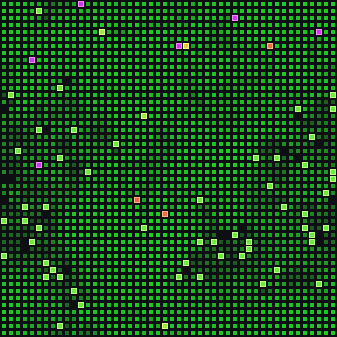
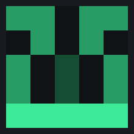
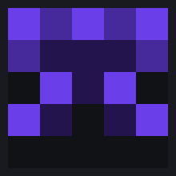
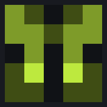
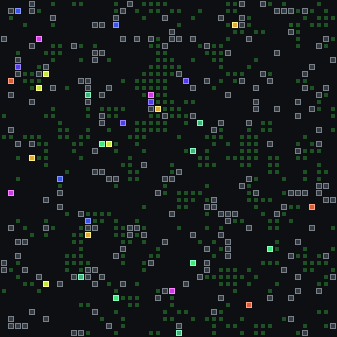

# 🧬 Vivarium — a living world inside your Hermes agent

<p align="center">
  
</p>

Vivarium is a Hermes Agent plugin that hosts a **persistent artificial-life
living world**. A 48×48 cellular-automaton dish: food blooms and spreads like
weather, and genome-carrying creatures forage, reproduce, mutate, and go
extinct on their own — even while you're away.

The twist: **your real work feeds it.** Every tool call your agent makes drops
nutrients into the dish. A busy coding day causes a population boom; a lazy
Sunday is a famine. The dish is a living mirror of how much — and how hard —
you've been using your agent. And when your agent *learns a new skill*, that
skill's content is hashed into a genome: **a brand-new species is born from
the actual work your agent does.**

**The world is called Vivarium. Each creature is a Hermi. You grow both.**

## The Four Rules

1. **Not random.** Dynamics are pure functions of state; the only entropy
   event is the creation of your universe key, outside the simulation. The
   same skills always produce the same species.
2. **Mathematically sound.** Every mechanism is a measurable constant with a
   documented role — carrying capacity, energy conservation with friction,
   logistic regrowth. Nothing is tuned by vibes.
3. **Discovery is the game.** The **Vivarium Codex** records emergent patterns your dish
   exhibits (population pulses, still lifes), each with evidence and rendered
   artifacts. Scarcity comes from survival, never from payment.
4. **Private.** Species derive from keyed hashes of your skill *content* —
   never names, never raw content. Your universe key stays on your machine;
   shared artifacts carry only Eidos IDs and fingerprints.

## Install

Requires [Hermes Agent](https://hermes-agent.nousresearch.com/docs). Clone
this plugin into your Hermes plugins directory and restart:

```bash
git clone https://github.com/r3adaszer0/vivarium.git \
  ~/.hermes/plugins/vivarium
# then restart Hermes — the plugin loads and the dish awaits its first skill
```

Your universe starts **dormant** — the dish is empty and silent. The first
skill your agent learns triggers the Big Bang: species are seeded from every
skill installed at that moment (the shared founding kit plus your own), and
the dish comes alive. Until then, using your agent banks nothing — the world
begins the day it's born.

## What you can do

| Command | Effect |
|---|---|
| `/vivarium status` | population, lineages, age pyramid, ASCII map |
| `/vivarium feed 0.5` | drop nutrients into the dish |
| `/vivarium codex` | the Vivarium Codex: discoveries + artifacts |
| `/vivarium release` | release fresh founders |
| `/vivarium import <code>` | release a strain from a challenge code |
| `/vivarium staleness` | is the living world going stale? |
| `/vivarium restart` | end the era; the next skill births a new universe |

Every species gets a **5×5 mirrored glyph** and a binomial name derived
deterministically from its genome — the same genome grows the same face in any
renderer:

<p align="center">
  &nbsp;
  &nbsp;
  
</p>

## The Vivarium Codex

The dish develops emergent dynamics. When a pattern is confirmed — a
**Still Life** (a stable plateau) or a **Pulse** (a boom→crash→recovery
cycle) — it enters your Codex with its evidence, and a rendered snapshot of
the dish at the moment of discovery:

<p align="center">
  
</p>

Patterns can end. When a plateau breaks, the entry records *why* — often a
speciation event: a newly learned skill landing in a saturated world.

Zoom in anywhere, any time: the simulation is deterministic, so any past
moment re-renders exactly. [Watch a bloom close-up](docs/assets/clip_bloom_zoom.mp4).

## How it works (short version)

- **Food** regrows logistically and diffuses to neighbors — weather-like
  blooms and barren fronts travel across the dish.
- **Creatures** carry six genes (forage, aggression, metabolism, sense,
  mutation rate, hue) driving real dynamics: contested feeding, live
  metabolic drain, conservation-split reproduction. Eat → reproduce;
  starve → die.
- **Skills → species:** `SHA-256` over skill content (keyed by your universe
  key for private skills; a public domain-separated digest for stock skills)
  selects 192 bits of genome. Deterministic, private, collision-safe.
- **Two clocks:** time ticks (a tool call ≈ 6 ticks); skills punctuate
  (speciation events). *Time ticks; skills punctuate.*
- **Deterministic per seed:** the same seed and actions reproduce the same
  history, so challenge duels are verifiable.
- **Zero dependencies** — pure Python stdlib.

Deep-dive documents: [the Compendium](docs/vivarium_compendium.pdf) (design,
math, comparisons to cellular automata and related work) and the
[plain-language user guide](docs/user_guide.pdf).

## Research

Long-run dishes converge to 1–2 dominant lineages — island-biogeography
dynamics, documented honestly. **Skill-births are the immigration pump**:
diversity in this world comes from your agent's real learning.

The optional, opt-in **Vivarium Census** (planned) would let users contribute
their universe's anonymized population records to a community dashboard —
thousands of worlds, one physics, real human-AI input streams. See the
Compendium, Part 15b.

## Try it

```text
/vivarium status
/vivarium feed 2.0        # a feast
/vivarium release         # fresh founders
/vivarium import VIV1eyJ...
```

## Status

v0.1.0 — under active development for the
[Nous Research Hermes Agent Plugin Hackathon](https://x.com/NousResearch)
(Nov 2026). 82 tests green. Contributions and challenge-code duels welcome.

## License

MIT — see [LICENSE](LICENSE).
