# 🧬 Vivarium — a living world inside your Hermes agent

<div align="center">
<table border="0" cellspacing="0" cellpadding="0">
<tr>
<td valign="middle">
  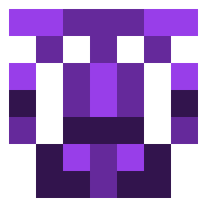<br>
  <sub><b>Venefica ferox</b><br>Eidos_bff77f92</sub><br><br>
  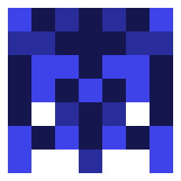<br>
  <sub><b>Vivax minor</b><br>Eidos_e45f9549</sub>
</td>
<td valign="middle" align="center">
  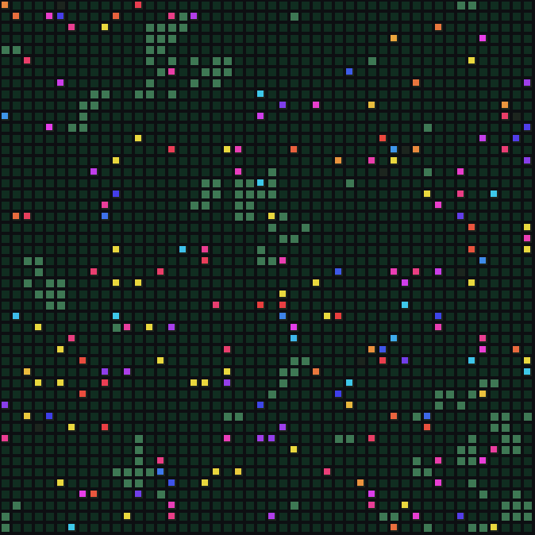
</td>
<td valign="middle">
  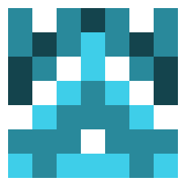<br>
  <sub><b>Foragia tenuis</b><br>Eidos_ef543f71</sub><br><br>
  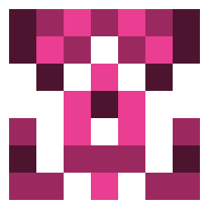<br>
  <sub><b>Venefica major</b><br>Eidos_01ff7d80</sub>
</td>
</tr>
</table>
</div>

Vivarium is a Hermes Agent plugin that hosts an **artificial-life
living world**. A 48×48 cellular-automaton dish: food blooms and spreads like
weather, and genome-carrying creatures forage, reproduce, mutate, and go
extinct on their own — even while you're away.

The twist: **your real work feeds it.** Every tool call your agent makes drops
nutrients into the dish. A busy coding day causes a population boom; a lazy
Sunday is a famine. The dish is a living mirror of how much — and how hard —
you've been using your agent. And when your agent *learns a new skill*, that
skill's content is hashed into a genome: **a brand-new species is born from
the actual work your agent does.**

**The world is called Vivarium. Each creature is a Hermi. You grow both.**

## Vivarium is:

- **Deterministic.** Dynamics are pure functions of state; the only entropy
  event is the creation of your universe key, outside the simulation. The
  same skills always produce the same species.
- **Mathematically sound.** Every mechanism is a measurable constant with a
  documented role — carrying capacity, energy conservation with friction,
  logistic regrowth. Nothing is tuned by vibes.
- **Genetic.** Every Hermi carries a six-gene genome — forage, sense,
  metabolism, aggression, mutation rate, dispersal — inherited with
  mutation from its parents, and every species descends from a skill your
  agent actually learned. The face, the name and the colour are all read
  off the genes.
- **Private.** Species derive from keyed hashes of your skill *content* —
  never names, never raw content. Your universe key stays on your machine;
  shared artifacts carry only Eidos IDs and fingerprints.

## Install

Requires [Hermes Agent](https://hermes-agent.nousresearch.com/docs).

```bash
git clone https://github.com/r3adaszer0/vivarium.git \
  ~/.hermes/plugins/vivarium
```

Then start Hermes and say:

```text
/vivarium start
```

Your universe starts **dormant**, the dish is empty and silent. The next
skill your Hermes agent learns triggers the **Big Bang**. From then on,
using your agent advances the time of the world, and each new skill your
agent learns introduces a new species.

**Where it has been tested:**

| Surface | Status |
|---|---|
| **kitty** | fully tested |
| **ghostty** | fully tested |
| **Matrix** | works; the dish arrives where a skill is born, but choosing a specific channel is not supported yet |
| **Hermes Desktop** | works, without the full paint quality of a graphics terminal |
| **iTerm2 and sixel terminals** | untested |
| **Your browser** | `/vivarium serve` turns the dish into a private local web page: the live dish, the registry and every certificate, served only on your machine (127.0.0.1) |

Pure Python stdlib, zero dependencies.

## Meet the Hermi

A Hermi is a creature of the dish: a 7x7 pixel face, a binomial name,
a colour it inherits from its lineage, and a genome of seven genes that
decides how it lives.

**Where it comes from.** When your agent learns a skill, the skill's
content is hashed, keyed by your universe key, and read as a genome:
four bytes for each of seven genes, plus the hue that paints it. The
same skill grows the same species in any universe, on any machine.
Deterministic, private.

**Its genes.** Six genes evolve, one is fixed. Forage sets how fast a
Hermi gathers food. Sense sets how far ahead it sees a bloom. Metabolism
sets how fast it burns what it eats. Aggression decides who wins a
contested cell. Mutate sets how far its children drift from it.
Dispersal decides whether it stays in a crowded cell or sets out for
open ground. Hue is the seventh gene, and it is fixed: inherited
exactly, never jittered, the colour of its lineage on the dish.

**How many.** Seven genes of four bytes each: 224 bits, about 2.7 x
10^67 possible Hermi. That is more possible Hermi than there are atoms
on Earth. No two different skills, anywhere, ever, will grow the same
species twice. And they are sourced from everywhere your agent has
already been: the Big Bang seeds a species from every skill installed
at genesis, and each new skill introduces one more, one unique.

**How they evolve.** A Hermi that eats splits its energy into children;
a Hermi that starves dies. With every birth the genes drift, so the
children are never exact copies: a little faster to forage, a little
slower to burn, a little bolder in a crowd. The dish decides which
drifts survive. Lineages rise, dominate for an age, and go extinct,
and the fossils keep the record of every one of them.

**The physics.** Food regrows logistically and diffuses to its
neighbours, so blooms travel across the dish like weather. A tool call
ticks the world about six ticks; a learned skill punctuates it with a
speciation event. Time ticks; skills punctuate.

<div align="center">
<table border="0" cellspacing="0" cellpadding="0">
<tr>
<td align="center">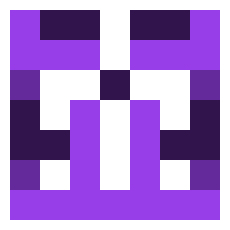<br><sub><b>Oculata minor</b><br>Eidos_c2df1e99</sub></td>
<td align="center">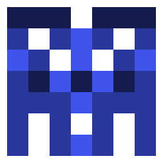<br><sub><b>Vivax ferox</b><br>Eidos_8acf7239</sub></td>
<td align="center">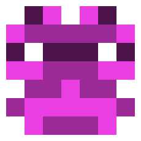<br><sub><b>Venefica serena</b><br>Eidos_62bf3b8f</sub></td>
<td align="center">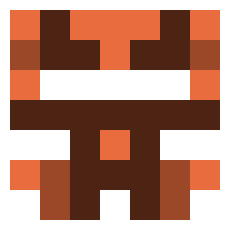<br><sub><b>Chroma pinguis</b><br>Eidos_6b584af1</sub></td>
</tr>
<tr>
<td align="center">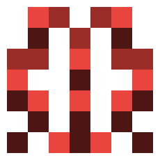<br><sub><b>Foragia vagans</b><br>Eidos_e38187eb</sub></td>
<td align="center">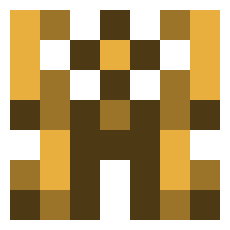<br><sub><b>Chroma minor</b><br>Eidos_08f3e7f9</sub></td>
<td align="center">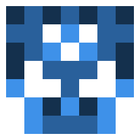<br><sub><b>Foragia minor</b><br>Eidos_f8f2a937</sub></td>
<td align="center">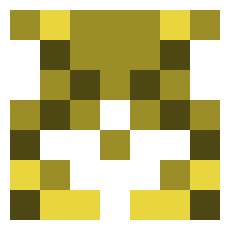<br><sub><b>Chroma robusta</b><br>Eidos_d5fc014b</sub></td>
</tr>
</table>
</div>

Deep-dive documents: [the Compendium](docs/vivarium_compendium.pdf) (design,
math, comparisons to cellular automata and related work) and the
[plain-language user guide](docs/user_guide.pdf).

## What you can do

| Command | Effect |
|---|---|
| `/vivarium status` | population, lineages, age pyramid, ASCII map |
| `/vivarium show <name\|id>` | a species up close: face, genes, founding skill |
| `/vivarium clip [species] [ticks]` | your world as a short video |
| `/vivarium explain` | how a hash becomes a living creature |
| `/vivarium feed 0.5` | drop nutrients into the dish |
| `/vivarium codex` | the Vivarium Codex: discoveries + artifacts |
| `/vivarium release` | release fresh founders |
| `/vivarium import <code>` | release a strain from a challenge code |
| `/vivarium race <seed> <codes>` | a deterministic species duel, verifiable anywhere |
| `/vivarium images on\|off\|auto` | inline dish painting in graphics terminals |
| `/vivarium narration on\|off` | the walkthrough story beats |
| `/vivarium start` | welcome briefing + the universe view |
| `/vivarium staleness` | is the living world going stale? |
| `/vivarium restart` | end the era (with a farewell picture); the next skill births a new universe |

## The Vivarium Codex

The dish develops emergent dynamics. When a pattern is confirmed — a
**Still Life** (a stable plateau) or a **Pulse** (a boom→crash→recovery
cycle) — it enters your Codex with its evidence, and a rendered snapshot of
the dish at the moment of discovery:

<p align="center">
  
</p>

Patterns can end. When a plateau breaks, the entry records *why* — often a
speciation event: a newly learned skill landing in a saturated world.

Zoom in anywhere, any time: the simulation is deterministic, so any past
moment re-renders exactly. [Watch a bloom close-up](docs/assets/clip_bloom_zoom.mp4).


## Voice: the dish speaks only when it has something to say

Vivarium never talks over your agent. Hermes answers you; the dish keeps
living quietly in the background, advancing as you use it. It speaks only
after the turn is over, and only about events:

- **off** no announcements; ask any time with `/vivarium status`
- **births** (default) a beat and the dish when a species is born
- **milestones** births, extinctions and Codex discoveries
- **daily** milestones plus one report on the first use of each day

`/vivarium narration off|births|milestones|daily`

A species is its content: learning the same thing under another name
does not spawn a twin. Several births in one turn arrive as one message.

## The first run: four acts

Vivarium introduces itself the way a world should: one beat per turn, each tied to something you actually did.

1. **Act 1, the dormant universe.** Your first conversation: the dish is empty and waiting. The first skill your agent learns lights it.
2. **Act 2, the Big Bang.** That first skill seeds the world from every skill installed at that moment. The narration explains the dish, the food, the Hermi, and the loop: your work feeds them, your learning births species.
3. **Act 3, the first Hermi by name.** The next skill births a species you meet properly: `/vivarium show Eidos_xxxxxx` for its face and genes, `/vivarium clip` for a short video of its world.
4. **Act 4, multiplayer.** A third birth opens the competitive horizon: `/vivarium export` shares a sealed genome, `/vivarium race` runs a deterministic duel anyone can verify.

Two beats fire on their own events: the **Codex introduces itself** at your first discovery, and an **extinction** gets its honest line. Story beats arrive in the same turn they happen, and never as a wall of text. `/vivarium narration off` keeps only bare birth lines (names and IDs).

## Where it lives: the experience by surface

The same universe, seen differently depending on where you talk to your agent:

| Surface | What you get | Status |
|---|---|---|
| **Terminal (kitty, ghostty, WezTerm, iTerm2)** | the full experience: the dish paints inline as a real image on births and `/vivarium render`, walkthrough narration, ASCII fallback everywhere | tested |
| **Any other terminal** | the rich block-character map (░▒▓█), never bare dots | tested |
| **Matrix (and other chat platforms)** | native dish photos in the room where a skill is born; `/vivarium start` gives the picture file + rich map | tested (Matrix) |
| **Hermes Desktop** | the same agent, same plugin; dish images arrive as files/attachments | expected to work |
| **Web UI** | a management dashboard, not a chat surface — not part of gameplay | n/a |

On any surface, the walkthrough adapts: inline paint where the host can
paint, native attachments where the gateway can attach, paths + the rich map
everywhere else.

## Research

Long-run dishes converge to 1–2 dominant lineages — island-biogeography
dynamics, documented honestly. **Skill-births are the immigration pump**:
diversity in this world comes from your agent's real learning.

The optional, opt-in **Vivarium Census** (planned) would let users contribute
their universe's anonymized population records to a community dashboard —
thousands of worlds, one physics, real human-AI input streams. See the
Compendium, Part 15b.

## Try it

```text
/vivarium status
/vivarium feed 2.0        # a feast
/vivarium release         # fresh founders
/vivarium import VIV1eyJ...
```

## Status

v0.1.0 — under active development for the
[Nous Research Hermes Agent Plugin Hackathon](https://x.com/NousResearch)
(Nov 2026). 183 tests green. Contributions and challenge-code duels welcome.

## License

MIT — see [LICENSE](LICENSE).
